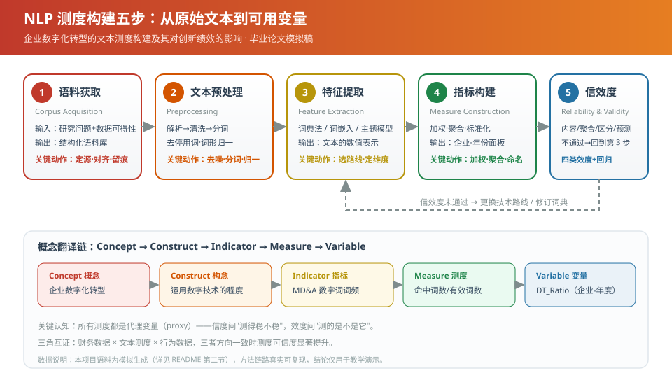

# 企业数字化转型的文本测度构建及其对创新绩效的影响

> 基于沪深 A 股上市公司年报"管理层讨论与分析（MD&A）"文本的实证研究
> —— 一篇遵循 **NLP 测度构建五步法** 的毕业论文模拟稿

[](https://www.python.org/)
[](LICENSE)
[](#)
[](https://github.com/qw77777/nlp-digital-transformation-thesis)

**仓库地址**：<https://github.com/qw77777/nlp-digital-transformation-thesis>

---

## 一、这是什么

本项目是一篇管理学本科毕业论文"**预演/模拟稿**"的完整配套材料，演示如何把**一段文字**
变成**一个能进论文的变量**，并进一步用于解释企业管理现象。

选题落在"大数据管理与应用"专业最典型的交叉领域：

| 层次 | 内容 |
|---|---|
| **概念 Concept** | 企业数字化转型 |
| **构念 Construct** | 企业在战略与运营中运用数字技术的程度 |
| **指标 Indicator** | 年报 MD&A 中数字化转型关键词的词频占比 |
| **测度 Measure** | `DT_Ratio = 命中词数 / 有效词数 × 100` |
| **变量 Variable** | 进入面板回归的 `DT_Ratio`（企业-年度） |

研究主线：**数字化转型测度 → 信效度检验 → 对企业创新绩效的影响**。

---

## ⚠️ 二、重要声明（请先读这一条）

**本项目的数据为「模拟生成（synthetic）」，不是真实的上市公司数据。**

真实的年报全文受版权与商业数据库（Wind / CSMAR / 巨潮）授权限制，无法随代码公开分发。
为使"语料获取 → 预处理 → 特征提取 → 指标构建 → 信效度检验"五步流程**可完整复现**，
`code/01_generate_corpus.py` 用一个潜在变量 `DT*` 作为数据生成过程，同时生成：

1. 企业-年度 **MD&A 模拟文本**（数字化句 + 中性经营句）；
2. 企业-年度**财务面板**（规模、杠杆、ROA、研发强度、专利、无形资产等）；
3. 一个第三方"数字化转型指数"（模拟），用于聚合效度检验。

因此：

- 本项目的**方法链路是真实、可复现、可迁移**的；
- 全部**统计结论仅用于演示方法**，**不得**被引用为关于中国上市公司的经验证据；
- 若要开展真实研究，只需把 `data/raw/` 中的模拟文件替换为真实年报语料与财务数据，
  后续 `02—06` 号脚本**无需修改**即可运行。

---

## 三、NLP 测度构建五步（本项目的骨架）

```
① 语料获取  Corpus Acquisition     → code/01_generate_corpus.py
② 文本预处理 Preprocessing          → code/02_preprocessing.py
③ 特征提取  Feature Extraction      → code/03_feature_extraction.py
   ├─ 路线一 词典法 Dictionary
   ├─ 路线二 词嵌入 Word2Vec / LSA
   └─ 路线三 主题模型 LDA
④ 指标构建  Measure Construction    → code/04_measure_construction.py
⑤ 信效度检验 Reliability & Validity → code/05_validity_reliability.py
   （+ 实证分析 → code/06_regression_analysis.py）
```



---

## 四、目录结构

```
nlp-digital-transformation-thesis/
├── README.md
├── LICENSE
├── requirements.txt
├── .gitignore
├── code/                          # 全部可复现代码
│   ├── nlp_utils.py               # 词典、句库模板、停用词、路径常量
│   ├── 01_generate_corpus.py      # ① 语料获取（生成模拟语料与财务面板）
│   ├── 02_preprocessing.py        # ② 文本预处理（清洗/分词/去停用词）
│   ├── 03_feature_extraction.py   # ③ 特征提取（词典法/词嵌入/LDA）
│   ├── 04_measure_construction.py # ④ 指标构建（L1/L2/L3 与面板）
│   ├── 05_validity_reliability.py # ⑤ 信效度检验
│   ├── 06_regression_analysis.py  # 实证分析（主回归/稳健性/异质性/图表）
│   └── run_all.py                 # 一键复现全部流程
├── data/
│   ├── raw/                       # 原始模拟数据（语料 + 财务面板）
│   ├── interim/                   # 预处理与特征提取中间结果
│   └── processed/                 # 最终企业-年份面板
├── results/
│   ├── tables/                    # 全部结果表（CSV）
│   └── figures/                   # 全部图（PNG）
├── paper/
│   └── 毕业论文_企业数字化转型NLP测度.md   # 论文全文（≥6000 字）
├── references/
│   └── 参考文献.md                 # 参考文献（GB/T 7714 体例）
└── docs/
    └── 五步流程图.svg
```

---

## 五、快速开始

```bash
# 1) 创建虚拟环境（推荐）
python -m venv .venv
# Windows
.venv\Scripts\activate
# macOS / Linux
source .venv/bin/activate

# 2) 安装依赖
pip install -r requirements.txt

# 3) 一键复现全部结果
python code/run_all.py
```

运行完成后：

- 结果表：`results/tables/`
- 图：`results/figures/`
- 最终面板：`data/processed/firm_year_panel.csv`
- 论文全文：`paper/毕业论文_企业数字化转型NLP测度.md`

> 注：`gensim` 为可选项。未安装时，词嵌入路线自动退化为
> LSA（TF-IDF + TruncatedSVD），流程仍可完整跑通。

---

## 六、结果一览

| 类别 | 文件 | 说明 |
|---|---|---|
| 内容效度 | `table_content_validity.csv` | 60 词数字化转型词典及其维度、权重 |
| 聚合效度 | `table_convergent.csv` | 与词嵌入法、LDA、第三方指数的相关 |
| 区分效度 | `table_discriminant.csv` | 与规模、杠杆、ROA 等低相关 |
| 预测效度 | `table_predictive.csv` | 对研发投入/专利产出的回归 |
| 信度 | `table_reliability.csv` | Cronbach α、分半、跨期相关 |
| 方差分解 | `table_variance_decomp.csv` | 企业间/企业内差异占比 |
| 主回归 | `table_main_regression.csv` | 数字化转型 → 创新绩效 |
| 稳健性 | `table_robustness.csv` | 换口径 / 换变量 / 滞后 / 剔样本 |
| 异质性 | `table_heterogeneity.csv` | 国企 vs 非国企；高技术 vs 传统 |

---

## 七、可复现性

- 全流程随机种子固定为 `RANDOM_SEED = 20260411`；
- 词典、句库模板、停用词集中在 `code/nlp_utils.py`，保证三步共用同一套口径；
- 每一步的中间产物均落盘（`data/interim/`），便于逐步检查与回溯；
- 所有路径基于 `pathlib` 相对项目根目录定位，不依赖工作目录。

---

## 八、引用

若本项目的代码或流程对你的研究有帮助，可参考以下格式（按需替换为你的信息）：

```bibtex
@misc{digital_transform_nlp_2026,
  title  = {企业数字化转型的文本测度构建及其对创新绩效的影响：方法与代码},
  author = {qw77777},
  year   = {2026},
  note   = {NLP 测度构建五步法教学演示项目},
  url    = {https://github.com/qw77777/nlp-digital-transformation-thesis}
}
```

## 九、许可

代码以 [MIT License](LICENSE) 开源；论文文本仅用于教学演示，请勿直接用于正式提交。
