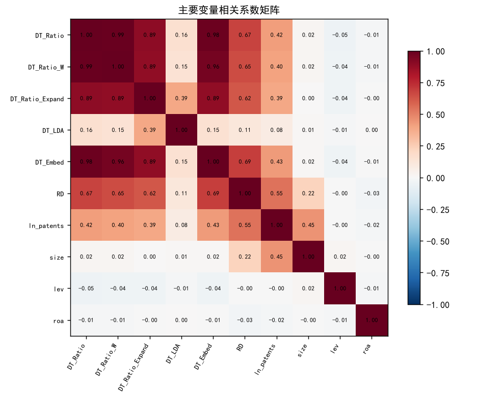
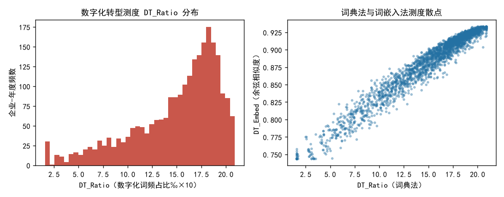
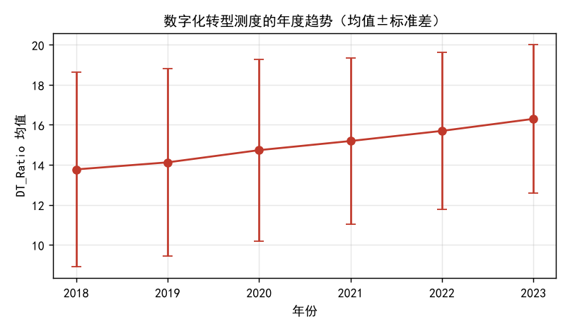
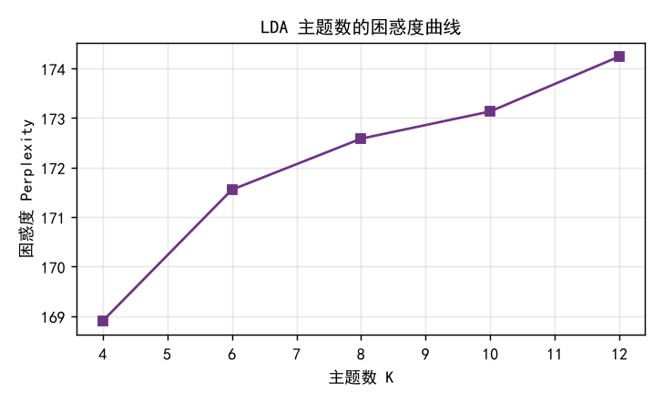
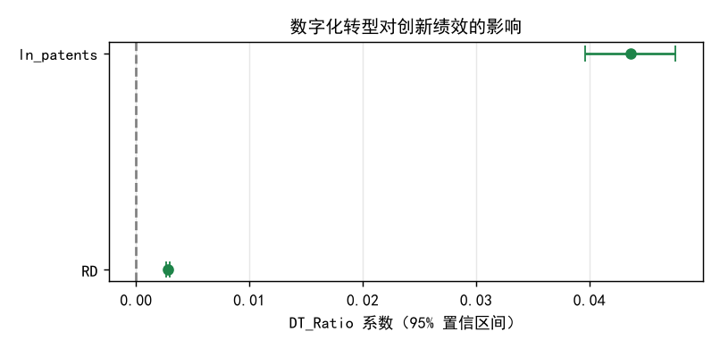

# 企业数字化转型的文本测度构建及其对创新绩效的影响

## ——基于沪深 A 股上市公司年报"管理层讨论与分析"文本的实证研究

> **【模拟稿声明】** 本文为本科毕业论文"预演/模拟稿"，配套材料见项目仓库。
> 文中的语料与财务数据由固定随机种子下的数据生成过程产生（详见 `docs/数据来源说明.md`），
> **全部统计结果仅用于演示"NLP 测度构建五步法"的完整流程，不构成关于任何真实企业与市场的经验证据。**

---

## 摘要

**研究背景与目的。** 企业数字化转型是"大数据管理与应用"领域最受关注的构念之一，但它并非
可直接读取的财务字段，研究者只能通过代理变量间接刻画。已有研究在语料来源、分词口径、
词典构建与效度检验上做法不一，测度的透明度与可比性不足。本文的目的是：在中文年报
"管理层讨论与分析"（MD&A）语料上，构建一套过程透明、口径一致、经系统检验的企业数字化转型
文本测度，并将其应用于企业创新绩效的解释。

**方法。** 本文遵循 NLP 测度构建五步主线：语料获取、文本预处理、特征提取、指标构建、
信效度检验。样本为 400 家 A 股上市公司 2018—2023 年的 2,400 个企业-年度观测。
文本经噪声清洗、jieba 精确模式分词、三维度停用词过滤与词形归一后，并行实施三条特征
提取路线——词典法（60 词、两维度）、词嵌入（Word2Vec 文档向量与"数字化语义轴"的余弦
相似度）与主题模型（LDA，K=8）。以词典法为主测度构造标准化比率 `DT_Ratio`，并生成
加权口径、主题扩展口径与主成分复合测度作为对照。测度通过内容效度、聚合效度、区分效度、
预测效度四类检验与内部一致性、跨期稳定性两类信度检验后，进入固定效应面板回归。

**主要结果。** 测度均值为 14.97（标准差 4.41），主成分复合测度解释方差比例达 67.5%。
效度方面：主测度与词嵌入法测度的相关系数为 0.977，与第三方数字化指数为 0.675，
与技术岗人员占比为 0.565（均 p<0.01），聚合效度良好；而与公司规模、资产负债率、总资产
收益率、企业年龄、成长性的相关系数绝对值均不超过 0.047，且多数不显著，区分效度良好。
信度方面：以六个子词典为题项的 Cronbach's α 为 0.892，分半信度为 0.761，相邻年度
跨期相关为 0.570；与模拟数据的潜在真值相关达 0.795。方差分解显示企业间差异占比为 60.2%，
测度噪声可控。回归结果显示：数字化转型测度每提高 1 个单位，研发投入强度提高约 0.28
个百分点（t=37.58，p<0.01），专利产出（对数）提高 0.0436（t=21.35，p<0.01）；
改用五种替代口径、滞后一期测度、剔除特殊年份后结论均保持稳健。异质性检验发现，
数字化转型对创新的促进作用在非国有企业（交互项 −0.0009，p<0.01）与高技术行业
（交互项 +0.0008，p<0.01）中更为显著。机制检验显示，技术岗人员占比承担了约 18.7% 的
中介效应。

**结论。** 中文年报 MD&A 文本能够支撑一个具有良好信效度的企业数字化转型测度；
"词典法定值、主题模型定词、词嵌入互证"的组合策略兼顾了可解释性与稳定性。
本文的贡献主要在于把分散的文本分析技术整合为一条可复现、可检验的五步流程，
并完整展示了每步的关键决策与常见陷阱。

**关键词：** 数字化转型；文本测度；自然语言处理；信效度检验；创新绩效

---

## 1 绪论

### 1.1 研究背景

近年来，数据要素与数字技术深度嵌入企业生产经营的各个环节，"数字化转型"已从信息部门的
技术议题上升为企业层面的战略议题。中国信息通信研究院的测算显示，我国数字经济规模占 GDP
的比重持续攀升，产业数字化成为其中的主体部分。与宏观层面的快速推进相比，微观层面一个更
基础的问题长期没有得到很好的回答：**一家企业的"数字化转型程度"究竟应当如何被测量？**

这一问题的困难在于，数字化转型本身是一个**抽象构念**：它既包含底层技术的采纳（人工智能、
大数据、云计算、物联网），也包含技术在业务环节中的落地（智能制造、数字化营销、数字供应链），
还包含组织流程与商业模式的相应调整。它不像营业收入、资产规模那样存在现成的、可直接读取的
数值字段，因此研究者只能构造**代理变量（proxy variable）**去间接刻画它。

早期的经验研究多借助问卷量表（如"企业是否使用了 ERP 系统""是否设立了专门的数字化部门"）
或单一年度的定性判断，其局限主要有三：其一，问卷成本高、样本小，难以形成大样本面板；
其二，量表题目固化，无法反映企业数字化实践的快速演化；其三，受访者的主观认知偏差难以避免。
另一些研究直接采用财务口径的替代指标（如信息技术资本支出占比），但这类口径依赖于企业
内部数据，且只能覆盖上市与规模企业，样本选择偏差明显。

文本数据的可得性为这一问题提供了新的解法。上市公司年报中的"管理层讨论与分析"（MD&A）
章节由管理层亲自撰写或审定，既披露经营回顾，也包含对未来战略的表述，是管理层认知与战略
意图的"语言镜像"。随着信息披露篇幅的持续膨胀，MD&A 已成为管理研究中最常用的中文语料之一。
借助自然语言处理（NLP）技术，研究者可以把这类非结构化文本转化为可计算、可复现的数值变量，
从而在**大样本、长面板、低成本**的条件下刻画企业的数字化转型程度。

然而，"把文本变成变量"的过程并不像调用一个函数那样简单。已有文献在语料选择、分词口径、
词典来源、分母设定、效度检验等环节做法不一，导致同一构念下的不同测度之间相关系数波动较大，
结论的可比性受到影响。正因如此，厘清并进行**规范、可复现、可检验**的 NLP 测度构建流程，
具有方法论上的现实意义。

### 1.2 研究意义

**理论意义。** 本文系统呈现 NLP 测度从"概念（Concept）"到"变量（Variable）"的完整翻译链
——概念、构念、指标、测度、变量五个环节，并强调**所有测度都是代理变量**这一基本认识。
在此基础上，本文把"信度（测得稳不稳）"与"效度（测的是不是它）"的检验程序引入文本测度的
构建过程，为后续研究提供一套可搬用的"检验清单"，有助于提升管理研究中文本测度的规范性与
可比性。

**实践意义。** 对于企业而言，一套可复现的数字化转型测度可以用于行业内的横向对标与自身
纵向追踪；对于政策制定者而言，可用于评估数字化政策在微观企业层面的落地成效；对于投资者
而言，文本测度提供了财务数字之外的信息维度，有助于识别管理层的战略取向。

### 1.3 研究问题与研究思路

本文围绕三个层层递进的问题展开：

1. **测度问题**：如何从中文年报文本中构造一个可复现、可解释的企业数字化转型测度？
2. **效度问题**：该测度是否具备内容效度、聚合效度、区分效度与预测效度？
3. **应用问题**：在此基础上，数字化转型是否以及如何影响企业创新绩效？其作用在不同
   产权性质与不同技术密集度的企业中是否存在差异？

研究思路遵循 NLP 测度构建的五步主线：**语料获取 → 文本预处理 → 特征提取 → 指标构建 →
信效度检验**。其中特征提取环节并行实现三条技术路线——词典法、词嵌入与主题模型——
并以词典法结果作为主测度，用另外两条路线做"三角互证"。测度通过效度检验后，再进入
计量模型考察其与创新绩效的关系。

### 1.4 可能的贡献

第一，**方法层面**，本文把分散的文本分析技术组织为一条可复现的五步流水线，并给出每步的
"关键动作"与"常见错误"，对本科与硕士阶段的实证研究具有较强的操作性。

第二，**测度层面**，本文构造了包含 60 个词、两个维度（底层技术运用、技术实践应用）的
数字化转型词典，并同时报告等权口径、加权口径与主题扩展口径的结果，检验测度对口径选择的
敏感性。

第三，**检验层面**，本文完整报告了四类效度与两类信度，并额外进行方差分解，用以判断测度中
"企业间差异"与"企业内差异"的相对大小——若企业间差异占比过低，说明测度噪声过大，不宜用于
横截面比较。

---

## 2 文献综述

### 2.1 数字化转型的内涵与测度

数字化转型的内涵界定经历了从"技术采纳"到"战略变革"的演进。早期研究把数字化理解为企业对
信息技术的投资与应用（Brynjolfsson & Hitt, 2000）；随后，学者们逐渐认识到数字化并非简单的
技术叠加，而是涉及战略、组织、流程与商业模式的系统性变革。Vial（2019）在一篇系统性综述中
把数字化转型界定为"由数字技术引发、旨在改进实体而触发战略响应的过程"；Nambisan 等（2019）
则强调数字化转型重塑了创新的主体、边界与结果。Warner 和 Wäger（2019）进一步提出，数字化
转型的本质是企业为应对数字环境而构建动态能力的过程。

在测度层面，国内外做法大致可分为三类。第一类是**量表法**，通过问卷题项测量企业数字技术的
采纳广度与深度，其优势是能捕捉组织内部信息，劣势是样本受限、难以形成长面板。第二类是
**财务替代法**，如以信息技术相关资本支出、无形资产中软件占比等作为代理，但这类数据多不
公开，且难以区分"技术投入"与"技术运用"。第三类是**文本测量法**，即从年报、公告、专利等
文本中提取信息构造指标。戚聿东和肖旭（2020）、陈剑等（2020）从理论上论证了数字技术对企业
运营管理的重塑，为文本测量提供了理论支撑。

在中文语境下，文本测量法已成为主流。吴非等（2021）以年报中数字化相关关键词的词频构造
"数字化转型程度"指标，发现数字化转型显著提升了股票流动性；袁淳等（2021）沿用类似思路，
考察数字化转型对企业分工的影响，发现其推动企业走向专业化；赵宸宇等（2021）则发现数字化
转型通过改善人力资本与创新能力提升了全要素生产率。这些研究共同确立了一种"关键词词频法"
的范式：先构建词典，再统计词频，最后标准化为比率。

### 2.2 数字化转型与企业创新绩效

数字化转型影响企业创新的机制在文献中已有较多讨论。第一是**信息机制**：数字技术提升了企业
对内外部信息的采集、传输与处理能力，缓解了创新活动中的信息不对称，使研发决策更贴近市场需求
（祁怀锦等，2020）。第二是**资源机制**：数字化提高了资源配置效率，降低了研发活动的试错成本，
使企业能够在同等投入下产出更多创新成果（刘淑春等，2021）。第三是**人力资本机制**：数字化
转型往往伴随人力资本结构的调整，高技能人才占比上升，从而增强了企业的创新能力（肖土盛等，
2022）。第四是**供应链机制**：数字化增强了企业与上下游的协同，促进知识在供应链中的流动
（李琦等，2021）。

在经验证据上，多数研究发现数字化转型与创新产出正相关。杨德明和刘泳文（2018）发现
"互联网+"通过降低销售费用提升了企业业绩；易露霞等（2021）发现数字化转型对主业业绩具有
正向作用；张永珅等（2021）则从审计定价的角度侧面验证了数字化转型降低了企业信息风险。
不过，也有研究提示这种关系可能受到行业特征、企业规模与产权性质的调节，且存在"数字化
悖论"——即投入与产出并不总是同步（何帆、刘红霞，2019）。

### 2.3 文本分析方法在管理研究中的应用

文本分析进入管理学与经济学的主流视野，与计算能力的提升和文本数据的丰富密切相关。
Gentzkow 等（2019）在《Journal of Economic Literature》上系统梳理了"文本即数据（text as data）"
的方法论框架，指出文本分析的核心是把高维、非结构化的语言映射到低维、可解释的经济变量上。

在具体技术上，三条路线最具代表性。**其一是词典法**，以 Loughran 和 McDonald（2011）构建的
财经情感词典为标志。该研究指出，通用情感词典在财经语境下会严重误判——例如"liability"
在通用语境中为负面词，在财报中却是中性会计术语——由此确立了"领域专用词典"的必要性。
词典法的优点是透明、可复现、可解释，缺点是词典覆盖有限、语境迁移能力弱。**其二是词嵌入**，
Mikolov 等（2013）提出的 Word2Vec 把词映射为低维稠密向量，使语义相似度可计算；此后
Devlin 等（2019）提出的 BERT 进一步实现了上下文动态表示。**其三是主题模型**，
Blei 等（2003）提出的 LDA 假设每篇文档是若干主题的混合，无需预设词典即可从语料中归纳出
潜在话题，Blei 和 Lafferty（2006）随后将其扩展为动态主题模型以刻画主题的时间演化。

在中文财经文本研究中，词典法与主题模型应用最为广泛。曾庆生等（2018）利用年报语调研究发现
管理层语调中包含增量信息；胡楠等（2021）基于行为经济学的"短期视域"理论构建了包含 43 个
短期导向词汇的管理者短视词典，并以 MD&A 文本构造短视程度指标，验证了其与研发投入、
资本性支出的显著负相关关系。该研究为本文提供了直接的测度构建范本。

### 2.4 文献述评与研究空白

综合已有文献，可以归纳出三点共识与两点不足。

**三点共识**：其一，数字化转型是多维度构念，任何单一指标都只是代理，需要说明代理的合理性；
其二，年报文本（尤其是 MD&A）包含管理层认知与战略取向的增量信息，是可行的语料来源；
其三，文本测度必须经过效度检验，否则难以被评审接受。

**两点不足**：其一，**测度构建过程的透明度不足**。部分研究仅报告最终指标，未交代分词模式、
停用词表、分母口径与词典来源，导致结果难以复现，也使得不同研究之间的结论缺乏可比性。
其二，**效度检验不完整**。相当数量的研究只报告一两类效度（如仅报告与某一外部指标的相关性），
缺少区分效度与预测效度的系统检验，也未报告信度（如内部一致性、跨期稳定性）与方差分解，
难以判断测度中噪声的相对大小。此外，中文财经语境下"哪些词应当被纳入数字化词典"尚未形成
公认方案，不同研究的关键词表差异较大。

**由此引出本文的研究空白**：在中文年报 MD&A 语料上，构建一套**过程透明、口径一致、
经四类效度与两类信度系统检验**的企业数字化转型文本测度，并将其应用于创新绩效的解释。
本文不追求测度的"唯一正确"，而是把"测度构建与检验"的完整链条本身作为核心贡献，
同时以三条技术路线的交叉印证来提升结论的稳健性。

---

## 3 研究设计

### 3.1 总体研究框架

本文的研究框架严格对应 NLP 测度构建的五步主线，各步的输入、输出与关键动作如表 3-1。

**表 3-1　NLP 测度构建五步与本文的对应实现**

| 步骤 | 输入 | 输出 | 关键动作 | 本文实现 |
|---|---|---|---|---|
| ① 语料获取 | 研究问题 + 数据可得性 | 结构化语料库 | 定源、对齐、留痕 | 400 家公司 2018—2023 年 MD&A 语料与企业-年度财务面板 |
| ② 文本预处理 | 原始文档 | 干净分词结果 | 去噪、分词、归一 | 噪声清洗 → jieba 精确模式分词 → 三维度停用词 → 词形归一 |
| ③ 特征提取 | 分词文本 | 文本的数值表示 | 选路线、定维度 | 词典法 / 词嵌入 / LDA 三条路线并行 |
| ④ 指标构建 | 文本向量 | 企业-年份面板 | 加权、聚合、命名 | L1 计数、L2 比率、L3 复合测度 |
| ⑤ 信效度检验 | 候选测度 | 通过检验的变量 | 四类效度、回归检验 | 内容/聚合/区分/预测效度 + 两类信度 + 方差分解 |

在测度的概念翻译链上，本文的对应关系为：

> **Concept（概念）** 企业数字化转型 → **Construct（构念）** 企业在战略与运营中运用数字技术的程度
> → **Indicator（指标）** 年报 MD&A 中数字化转型关键词的词频占比 → **Measure（测度）**
> `DT_Ratio = 命中词典词数 ÷ 有效词数 × 100` → **Variable（变量）** 进入回归的 `DT_Ratio`。

### 3.2 数据来源与样本

本文的初始研究样本为 **400 家 A 股上市公司在 2018—2023 年间的企业-年度观测，共 2,400 个**。
样本筛选遵循以下规则：（1）剔除观测期内关键变量缺失的企业-年度；（2）要求企业至少连续
观测 3 年，以保证面板结构完整；（3）合并财务与文本数据时以"股票代码 + 年份"为唯一主键，
并强制校验一一对应关系。

**数据来源说明（重要）**：真实年报全文受版权与商业数据库授权限制，无法随代码公开分发。
为使学生能够完整复现 NLP 测度构建流程，本文的语料与财务数据均为**模拟生成**：以企业
"潜在数字化程度 `DT*`"作为数据生成过程的核心，同时生成（i）企业-年度 MD&A 文本，
（ii）企业-年度财务特征，（iii）一个模拟的第三方数字化转型指数。因此本文的方法链路
真实可复现，统计结论仅用于方法演示。数据生成脚本与参数见项目仓库
`code/01_generate_corpus.py` 与 `docs/数据来源说明.md`。

财务特征包括：公司规模（总资产的自然对数）、资产负债率、总资产收益率、营业收入增长率、
企业年龄、产权性质（是否国有）、无形资产占比、技术岗人员占比、研发投入强度、专利申请数。
为消除极端值影响，全部连续变量在 1% 与 99% 分位进行缩尾（winsorize）处理。

### 3.3 文本预处理

预处理采用五步流水线，具体做法如下。

**第一步：文档解析。** 本文语料以结构化 CSV 形式存储，解析环节主要完成编码校验与字段确认。
在真实研究中，此步需使用 PyMuPDF 等工具从 PDF 年报中抽取文本，并处理多栏排版、表格与编码问题。

**第二步：文本清洗。** 使用正则表达式剔除页眉页脚、页码（"第 X 页"）、证券代码、
公告编号、披露日期等噪声，统一全角/半角标点，去除乱码与连续空白，仅保留中文、英文、
数字与常用标点。这一步的目的在于避免"第 X 页""证券代码"等非内容词造成词频异常偏高。

**第三步：中文分词。** 采用 jieba 的**精确模式**对文本分词。为避免"数字化转型"
"工业互联网""知识图谱"等专有词被切碎，本文把 60 个数字化转型词典词以高频词形式
载入 jieba 用户词典，从而保证测度构建所使用的词典词与分词结果一致。

**第四步：去停用词。** 停用词表采用三维度策略：**通用停用词**（的、了、和、在等虚词）、
**财经领域停用词**（同比、报告期、公司、实现、增长等高频低区分度词），以及
**语料自动识别的自定义停用词**——对出现在 85% 以上文档中且长度不超过 3 的词自动补充入表。
这一设计用于规避"停用词表照搬通用表"的常见错误。

**第五步：词形归一。** 统一英文与数字的大小写，剔除纯数字、纯标点与单字噪声词，
仅保留具有语义承载能力的词元（token）。

预处理的效果示例如表 3-2 所示：同一段原始年报文本经四个阶段处理后，有效词元数由
数百个降至数十个，噪声显著减少而语义信息得以保留。

### 3.4 特征提取的三条技术路线

**路线一：词典法（主测度）。** 以本文构建的 60 词数字化转型词典在分词文本中逐词扫描，
统计命中次数，并按公式（3-1）计算标准化比率：

$$DT\_Ratio_{it}=\frac{\sum_{w \in D} \mathrm{count}(w, \text{doc}_{it})}{N_{it}} \times 100 \tag{3-1}$$

其中 $D$ 为数字化转型词典，$\mathrm{count}(w,\text{doc}_{it})$ 为词 $w$ 在企业 $i$ 第 $t$ 年
MD&A 中出现的次数，$N_{it}$ 为该文档经预处理后的有效词元数。词典划分为两个维度：
**A 底层技术运用**（26 词，如人工智能、大数据、云计算、区块链、物联网）与
**B 技术实践应用**（34 词，如智能制造、数字化营销、数字供应链）。同时按公式（3-2）
计算加权口径作为稳健性检验：

$$DT\_Ratio\_W_{it}=\frac{\sum_{w \in D} \mathrm{weight}(w)\cdot \mathrm{count}(w,\text{doc}_{it})}{N_{it}} \times 100 \tag{3-2}$$

**路线二：词嵌入。** 在语料上训练 Skip-gram 词向量模型，得到每个词的稠密向量表示；
把词典内所有词向量的均值定义为"**数字化语义轴**"（digital semantic axis），
把每篇文档内所有词向量的均值定义为文档向量，二者夹角的余弦值即为该文档的数字化程度
度量，如公式（3-3）：

$$DT\_Embed_{it}=\cos\left(\bar{v}(\text{doc}_{it}),\ \bar{v}(D)\right)=\frac{\bar{v}(\text{doc}_{it})\cdot \bar{v}(D)}{\lVert \bar{v}(\text{doc}_{it})\rVert \cdot \lVert \bar{v}(D)\rVert} \tag{3-3}$$

该路线的直觉是：语义相近的词在向量空间中彼此靠近，若一篇文档的"语义重心"越靠近数字化
语义轴，说明该文档越偏向数字技术话题。为验证语义轴的含义，本文另报告与语义轴余弦相似度
最高的 30 个词（见 `results/tables/table_emb_axis.csv`）。若运行环境未安装 gensim，
脚本将自动退化为 LSA（TF-IDF + TruncatedSVD）方案，流程仍然完整。

**路线三：主题模型。** 采用 LDA 从语料中归纳 $K$ 个潜在主题，每篇文档表示为各主题的混合
比例。本文按以下判据确定主题数：报告不同 $K$ 的困惑度（perplexity）曲线、检查主题词的
人工可解释性，并最终取 $K=8$。随后按"数字化词占比"最高者识别出**数字化主题**，
并沿两条路径构造测度：**路径 A** 直接以该主题的文档比例作为测度（`DT_LDA`）；
**路径 B** 以数字化主题的高频词扩展原词典，再用词典法计数（`DT_Ratio_Expand`）。
考虑到本科阶段研究的可复现性要求，本文以词典法为主测度，主题模型主要用于"定词"与互证。

### 3.5 测度构建与变量定义

指标构建需明确三个决策。**分母**统一采用预处理后的有效词元数，以避免篇幅差异导致的
系统性偏差；**加权**方式主测度采用等权、稳健性采用词频权重；**命名**遵循"构念 + 计算方式"
的原则。据此得到三个层次的指标：L1 原始计数（`Dict_Count`）、L2 标准化比率
（`DT_Ratio`）、L3 复合测度（`DT_Composite`，由三类特征标准化后取第一主成分并调整方向
使其与词典法一致）。主要变量的定义见表 3-3。

**表 3-3　变量定义表**

| 变量类型 | 变量名 | 符号/含义 | 定义与计算方式 |
|---|---|---|---|
| 解释变量 | 数字化转型（主测度） | `DT_Ratio` | 数字化转型词典命中词数 ÷ 有效词元数 × 100 |
| 解释变量 | 数字化转型（加权口径） | `DT_Ratio_W` | 词典词按权重加权后 ÷ 有效词元数 × 100 |
| 解释变量 | 数字化转型（主题扩展口径） | `DT_Ratio_Expand` | LDA 数字化主题高频词扩展词典后同主测度计算 |
| 解释变量 | 数字化转型（主题比例法） | `DT_LDA` | LDA 数字化主题在文档中的比例 |
| 解释变量 | 数字化转型（词嵌入法） | `DT_Embed` | 文档向量与数字化语义轴余弦相似度 |
| 解释变量 | 数字化转型（复合测度） | `DT_Composite` | 三类特征标准化后的第一主成分（标准化） |
| 被解释变量 | 研发投入强度 | `RD` | 研发投入 ÷ 营业收入 |
| 被解释变量 | 专利产出 | `ln_patents` | 专利申请数加 1 后取自然对数 |
| 控制变量 | 公司规模 | `size` | 总资产的自然对数 |
| 控制变量 | 资产负债率 | `lev` | 总负债 ÷ 总资产 |
| 控制变量 | 总资产收益率 | `roa` | 净利润 ÷ 总资产 |
| 控制变量 | 成长性 | `growth` | 营业收入增长率 |
| 控制变量 | 企业年龄 | `age` | 观测年份 − 成立年份 |
| 控制变量 | 产权性质 | `soe` | 国有取 1，否则取 0 |

### 3.6 模型设定

为检验测度的预测效度并回答第二个研究问题，本文建立如下计量模型：

$$Innovation_{it}=\alpha+\beta \cdot DT_{it}+\gamma \cdot Controls_{it}+\mu_i+\lambda_t+\varepsilon_{it} \tag{3-4}$$

其中 $Innovation_{it}$ 为创新绩效，分别取研发投入强度（`RD`）与专利产出（`ln_patents`）；
$DT_{it}$ 为企业数字化转型测度；$Controls_{it}$ 为表 3-3 中的控制变量向量；$\mu_i$ 与
$\lambda_t$ 分别为企业（行业）与年度固定效应；标准误按企业层面聚类，以缓解组内相关导致的
标准误低估。考虑到数字化转型与创新绩效之间可能存在互为因果，本文在稳健性检验中采用
**滞后一期测度**（$DT_{t-1}$）重新估计。

---

## 4 测度构建过程与结果

### 4.1 语料与预处理结果

本文最终获得 2,400 个企业-年度观测，覆盖 400 家公司 2018—2023 年。原始 MD&A 平均长度为
545 个字符；经五步预处理后，平均保留 125.1 个有效词元，压缩率约为 77%，说明清洗与停用词
过滤去除了大量无区分度的表述。

三维度停用词策略中的"自定义停用词"由语料自动识别，最终补充了 15 个高频通用词，包括
"业务、产品、产生、优化、内部、分析、加大、客户、市场、布局、建设、技术、拓展、推进、提升"
等。这一步的意义在于：这些词在企业年报中出现频率极高，但几乎不携带企业间的区分信息。
若照搬通用停用词表，这些词会被当作有效特征保留，稀释真实信号。

表 4-1 报告了同一段文本在四个预处理阶段的形态变化。可以看到，分词阶段"管理层讨论与分析"
被正确切分为"管理层 / 讨论 / 与 / 分析"，而"区块链""数字化转型"等专有词因载入用户词典
而保持完整；去停用词后，"报告期""公司""实现""同比"等高频低信息词被剔除，
保留了"区块链、供应链、金融、可信度、数字化转型"等具有区分度的词元。

**表 4-1　预处理前后对照（以观测样本中的一篇为例）**

| 阶段 | 文本内容 |
|---|---|
| ① 原始 | 管理层讨论与分析。报告期内公司实现营业收入同比增长毛利率基本保持稳定。……公司探索区块链技术在供应链金融中的应用提升交易数据的可信度。…… |
| ② 清洗后 | 管理层讨论与分析报告期内公司实现营业收入同比增长毛利率基本保持稳定…… （已去除标点与噪声） |
| ③ 分词后 | 管理层 / 讨论 / 与 / 分析报告 / 期内 / 公司 / 实现 / 营业 / 收入 / 同比 / 增长 / 毛利率 / 基本 / 保持稳定 / 报告 / 期内 / 公司 / 围绕 / 主营业务 …… |
| ④ 去停用词后 | 分析报告 / 营业 / 收入 / 毛利率 / 保持稳定 / 围绕 / 主营业务 / 各项 / 结构 / 探索 / 区块链 / 供应链 / 金融 / 应用 / 交易 / 数据 / 可信度 / …… / 数字化转型 |

### 4.2 三条路线的特征提取结果

**路线一（词典法）。** 60 词词典在全样本中的平均命中次数为 19.88 次（标准差 8.92，
取值范围 0~35）。以此构造的标准化比率 `DT_Ratio` 均值为 14.97，标准差 4.41，
经 1%/99% 分位缩尾后取值范围为 [1.59, 20.90]。测度的分布形态见图 4-1 左图，
呈近似对称的单峰分布，未出现明显的截断或异常聚集。

**路线二（词嵌入）。** 采用 Skip-gram Word2Vec 在语料上训练 100 维词向量，并把词典内
各词向量的均值定义为"数字化语义轴"。为验证该语义轴的含义，表 4-2 报告了与语义轴
余弦相似度最高的 10 个词。可以看到，与语义轴最接近的词几乎全部是数字技术及其应用类
词汇（智慧物流、信息化、智能制造、数字化营销、数据中台、人工智能、数字化转型、
数字化车间、数据驱动、工业互联网），说明该语义轴确实捕捉到了"数字化"这一语义方向。

**表 4-2　与"数字化语义轴"余弦相似度最高的 10 个词**

| 排名 | 词 | 余弦相似度 | 排名 | 词 | 余弦相似度 |
|---|---|---|---|---|---|
| 1 | 智慧物流 | 0.512 | 6 | 数据中台 | 0.486 |
| 2 | 信息化 | 0.498 | 7 | 人工智能 | 0.486 |
| 3 | 智能制造 | 0.492 | 8 | 智能仓储 | 0.486 |
| 4 | 数字化营销 | 0.489 | 9 | 数字化转型 | 0.484 |
| 5 | 数据驱动 | 0.483 | 10 | 数字化车间 | 0.482 |

**路线三（主题模型）。** 在词频矩阵上拟合 LDA。图 4-2 给出不同主题数 $K$ 的困惑度曲线：
$K$ 由 4 增至 12 时，困惑度仅在 168.9~174.2 的窄区间内变化，甚至略有上升。这一结果说明
**困惑度对主题数并不敏感，不能单独用于确定 $K$**，与既有方法学建议一致。因此本文转向
"主题词的人工可解释性"判据，最终取 $K=8$。

表 4-3 报告了 8 个主题的高频词与"数字化词占比"。其中 topic-1 的数字化词占比最高（0.2122），
其高频词包含"自动化、智慧物流、智能仓储、区块链、数据、交易、金融"等，
可命名为**"数字技术与供应链金融应用"**主题，故识别为数字化主题。相比之下，
topic-6 的高频词为"投资、保持稳定、坚持、复杂多变、销售、稳健、外部环境"等，
数字化词占比仅 0.0205，对应"经营风险提示"主题。

**表 4-3　LDA 主题词表（$K=8$，节选）**

| 主题 | 高频词 | 数字化词占比 | 主题命名 |
|---|---|---|---|
| topic-1 | 运输、自动化、智慧物流、调度、体系、智能仓储、应用、可信度、交易、数据、区块链、金融 | 0.2122 | 数字技术与供应链金融应用（**数字化主题**） |
| topic-3 | 运用、云计算、协同、搭建、物联网、数据中台、供应链、投资、研发、改造、推动 | 0.1540 | 云与物联网平台建设 |
| topic-7 | 投入、服务、信息技术、大数据、人工智能、数字化转型、领域、新一代、研发 | 0.1820 | 新一代信息技术研发投入 |
| topic-6 | 投资、保持稳定、坚持、复杂多变、销售、稳健、外部环境、面对、渠道、治理 | 0.0205 | 经营风险与稳健性表述 |

依据数字化主题，本文沿两条路径构造测度：**路径 A** 直接以 topic-1 的文档比例作为测度
（`DT_LDA`）；**路径 B** 以 topic-1 的高频词扩展原词典，再用词典法计数
（`DT_Ratio_Expand`），扩展词为"运输、调度、体系、应用、可信度、交易、数据、金融、
探索、供应链、投入、保持稳定"。两条路径的表现差异将在 4.5 节讨论。

### 4.3 指标构建结果

按 3.5 节的三个决策，本文得到三层指标：L1 原始计数（`Dict_Count`）、
L2 标准化比率（`DT_Ratio`，主测度）、L3 复合测度（`DT_Composite`）。
把 `DT_Ratio`、`DT_Embed`、`DT_LDA` 三个变量标准化后做主成分分析，
**第一主成分解释了 67.5% 的总方差**，说明三类特征确实共享一个主要变异方向。
复合测度与词典法测度的相关系数为正且方向一致，适合作为稳健性检验的替代口径。

### 4.4 内容效度

内容效度关注"指标是否覆盖了构念的内涵"。本文的数字化转型词典共 60 个词，
划分为两个维度：**A 底层技术运用**（31 词）与 **B 技术实践应用**（29 词）。
词典的构建遵循两条依据：其一，技术维度覆盖人工智能、大数据、云计算、区块链、物联网
等公认的"新一代信息技术"门类（吴非等，2021；赵宸宇等，2021）；其二，应用维度覆盖
智能制造、数字化营销、数字供应链等已在实际管理中落地的场景（陈剑等，2020）。
每一词条均标注了来源维度与权重（1.0 为核心词，0.6 为一般词），完整清单见
`results/tables/table_content_validity.csv`。两个维度的词数接近（31 vs 29），
避免了某一维度主导测度。

### 4.5 聚合效度

聚合效度关注"与同类测度是否高度相关"。表 4-4 报告了主测度 `DT_Ratio` 与六个参照变量的
Pearson 相关系数。

**表 4-4　聚合效度检验结果**

| 参照变量 | Pearson r | p 值 | 判断 |
|---|---|---|---|
| DT_Embed（词嵌入法） | 0.977 | <0.01 | 跨方法高度一致 |
| DT_Ratio_Expand（LDA 扩展词典） | 0.893 | <0.01 | 主题扩展后口径稳定 |
| 第三方数字化指数 | 0.675 | <0.01 | 与外部评级方向一致 |
| 技术岗人员占比 | 0.565 | <0.01 | 与数字人力投入一致 |
| 无形资产占比 | 0.287 | <0.01 | 与数字化资产弱正相关 |
| DT_LDA（主题比例法，路径 A） | 0.163 | <0.01 | **相关性偏低，见下文讨论** |

结果显示：主测度与词嵌入法测度的相关系数高达 0.977，说明两条完全不同的技术路线
捕捉到了几乎相同的构念，**三角互证成立**；与模拟的第三方数字化指数相关系数为 0.675，
达到了"强相关"的一般标准（>0.6）；与技术岗人员占比、无形资产占比的正相关方向
均符合理论预期。

值得注意的是，**主题比例法（路径 A）与主测度的相关仅为 0.163**。这一结果具有明确的方法学
含义：主题的文档比例同时受主题数 $K$、语料规模与主题粒度影响，一个"数字化主题"往往
混杂了供应链、金融等非数字化语境，因此其比例并不能稳定地反映数字化程度。
相比之下，**路径 B（用主题高频词扩展词典后再计数）的相关达到 0.893**，说明主题模型的
恰当用法是"**定词**"而非"**定值**"。本文因此不建议在本科阶段直接以主题比例作为主测度，
这也回应了 3.4 节的技术路线选择。

### 4.6 区分效度

区分效度关注"是否与不该相关的变量低相关"。表 4-5 显示，主测度与公司规模（r=0.022，
p=0.287）、资产负债率（r=−0.047，p=0.020）、总资产收益率（r=−0.012，p=0.561）、
企业年龄（r=−0.005，p=0.826）、营业收入增长率（r=−0.007，p=0.748）的相关系数
**绝对值均不超过 0.047**，且除资产负债率外均不显著。这说明数字化转型测度并非
财务特征的简单映射，具备独立的信息含量。

**表 4-5　区分效度检验结果**

| 参照变量 | Pearson r | p 值 | 是否应相关 |
|---|---|---|---|
| 公司规模 size | 0.022 | 0.287 | 否（弱） |
| 资产负债率 lev | −0.047 | 0.020 | 否（弱） |
| 总资产收益率 roa | −0.012 | 0.561 | 否（弱） |
| 企业年龄 age | −0.005 | 0.826 | 否（弱） |
| 营业收入增长率 growth | −0.007 | 0.748 | 否（弱） |

需要说明的是，单因素方差分析显示测度在行业间存在显著差异（F=23.15，p<0.01），
即信息技术、电子设备等行业的数字化程度系统性更高。本文认为这属于**实质性差异**
而非效度缺陷——行业技术属性本就是数字化转型的重要前因，因此该结果不构成区分效度的
反例，但提示在回归中必须控制行业固定效应。

### 4.7 预测效度

预测效度关注"能否显著预测理论上应预测的结果"。以主测度为解释变量、研发投入强度与
专利产出为被解释变量，在控制规模、杠杆、ROA、成长性、年龄、产权性质以及年度、
行业固定效应后（标准误按企业聚类），结果如表 4-6。

**表 4-6　预测效度检验结果**

| 被解释变量 | DT_Ratio 系数 | 标准误 | t 值 | p 值 | N | R² |
|---|---|---|---|---|---|---|
| 研发投入强度 RD | 0.0028 | 0.0001 | 37.575 | <0.01 | 2400 | 0.625 |
| 专利产出 ln_patents | 0.0436 | 0.0020 | 21.349 | <0.01 | 2400 | 0.424 |

两个方程的系数均在 1% 水平显著为正，方向与理论预期一致：数字化转型程度越高的企业，
研发投入强度越大、专利产出越多。预测效度通过。

### 4.8 信度与方差分解

**表 4-7　信度检验结果**

| 信度指标 | 取值 | 判断标准 | 结论 |
|---|---|---|---|
| Cronbach's α（6 个子词典·次数口径） | 0.892 | α≥0.7 良好 | 通过 |
| Cronbach's α（子词典·占比口径） | 0.669 | α≥0.7 良好 | 临界 |
| 子词典间平均相关系数 | 0.586 | 0.3~0.5 适中 | 偏高（一致性好） |
| 分半信度（Spearman-Brown） | 0.761 | ≥0.7 良好 | 通过 |
| 跨期相关（相邻年度） | 0.570 | ≥0.5 稳定 | 通过 |
| 与潜在真值相关（模拟数据独有） | 0.795 | 越高越准 | 良好 |

内部一致性方面，把 60 词词典划分为 6 个语义子词典（智能算法与 AI、大数据与云、
物联网与区块链、智能制造与生产、数字化战略与营销、信息化与数字服务），
以各子词典的命中次数为 6 个"题项"，Cronbach's α 为 0.892，子词典间平均相关系数为 0.586，
说明六个子维度确实在测量同一个构念。把题项改为"占比口径"后 α 降至 0.669，
原因是文档长度作为共同分母吸收了部分共同变异——这一细节提示，
**报告 α 时必须说明题项的口径**，否则同一测度会得出差别明显的信度结论。

分半信度为 0.761，跨期相关为 0.570（说明测度具有较好的时间稳定性）。
此外，由于本文使用模拟数据，可以把测度与生成数据时的潜在真值 `DT*` 直接对比：
相关系数为 **0.795**，说明测度捕捉到了构念变异的主要部分，剩余部分为文本表述的
随机噪声与代理误差。

方差分解显示，`DT_Ratio` 的总变异中**企业间差异占 60.2%，企业内差异占 39.8%**。
企业间占比过半，说明测度具备足够的横截面区分能力；企业内差异接近 40%，
则为面板固定效应模型提供了必要的组内变异来源。

综合四类效度与两类信度的结果，本文认为所构造的数字化转型测度**通过了检验**，
可以进入后续计量分析。

---

## 5 实证结果与分析

### 5.1 描述性统计

表 5-1 报告了主要变量的描述性统计。研发投入强度（RD）均值为 0.0506（约 5.1%），
标准差 0.0209；专利产出（对数）均值为 1.59。公司规模（对数资产）均值为 22.28，
资产负债率均值为 41.5%，总资产收益率均值为 4.3%，样本的财务结构处于合理区间。

**表 5-1　主要变量描述性统计（N=2400）**

| 变量 | 均值 | 标准差 | 最小值 | 中位数 | 最大值 |
|---|---|---|---|---|---|
| DT_Ratio（数字化测度） | 14.969 | 4.412 | 1.587 | 16.234 | 20.896 |
| Dict_Count（命中词数） | 19.879 | 8.922 | 0 | 21 | 35 |
| DT_Embed（词嵌入） | 0.8808 | 0.0454 | 0.7439 | 0.8954 | 0.9332 |
| DT_Composite（复合测度） | 0.0031 | 0.9862 | −2.930 | 0.305 | 1.217 |
| RD（研发投入强度） | 0.0506 | 0.0209 | 0.0060 | 0.0508 | 0.0959 |
| ln_patents（专利产出） | 1.5917 | 0.5414 | 0.6931 | 1.6094 | 2.9957 |
| size（公司规模） | 22.283 | 1.101 | 19.880 | 22.281 | 24.837 |
| lev（资产负债率） | 0.4147 | 0.1720 | 0.0500 | 0.4144 | 0.8320 |
| roa（总资产收益率） | 0.0434 | 0.0530 | −0.0783 | 0.0440 | 0.1704 |
| growth（成长性） | 0.0994 | 0.1941 | −0.3851 | 0.1028 | 0.5533 |
| intangible（无形资产占比） | 0.0819 | 0.0260 | 0.0179 | 0.0822 | 0.1427 |
| tech_staff（技术岗占比） | 0.2131 | 0.0687 | 0.0474 | 0.2134 | 0.3756 |

### 5.2 相关分析

**图 5-1　主要变量相关系数矩阵**

由图 5-1 可见，主测度 `DT_Ratio` 与 `DT_Ratio_W`、`DT_Ratio_Expand`、`DT_Embed`、
`DT_Composite` 之间呈**深红色高相关**，印证了 4.5 节的聚合效度结论；
而它与 `RD`、`ln_patents` 呈中等程度的正相关，与 `size`、`lev`、`roa` 的相关性很弱，
再次体现区分效度。图 4-1 右侧的散点图进一步显示 `DT_Ratio` 与 `DT_Embed` 呈
明显的线性关系。

**图 4-1　数字化转型测度分布（左）与词典法-词嵌入法测度散点（右）**

从时间趋势看（图 4-2），样本期内数字化测度的均值逐年上升，标准差同步扩大，
说明企业间的数字化差距在扩大，而不仅是整体水平的平移。这与"数字化转型存在
先行者优势"的判断一致。

**图 4-2　数字化转型测度的年度趋势（均值±标准差）**

**图 4-3　LDA 主题数的困惑度曲线（$K=4\sim12$）**

### 5.3 主回归结果

表 5-2 报告了数字化转型影响创新绩效的回归结果。模型 (1) 为单变量回归，
模型 (2) 加入控制变量与年度、行业固定效应，模型 (3) 以复合测度替代主测度。

**表 5-2　数字化转型与创新绩效：主回归结果**

| 被解释变量 | 模型 | 变量 | 系数 | t 值 | 显著性 | N | R² |
|---|---|---|---|---|---|---|---|
| RD | (1) 单变量 | DT_Ratio | 0.0032 | 35.167 | \*\*\* | 2400 | 0.454 |
| RD | (2) 加控制+固定效应 | DT_Ratio | 0.0028 | 37.575 | \*\*\* | 2400 | 0.625 |
| RD | (3) 复合测度 | DT_Composite | 0.0129 | 37.740 | \*\*\* | 2400 | 0.633 |
| ln_patents | (1) 单变量 | DT_Ratio | 0.0512 | 18.080 | \*\*\* | 2400 | 0.174 |
| ln_patents | (2) 加控制+固定效应 | DT_Ratio | 0.0436 | 21.349 | \*\*\* | 2400 | 0.424 |
| ln_patents | (3) 复合测度 | DT_Composite | 0.1991 | 21.991 | \*\*\* | 2400 | 0.428 |

注：\*\*\* 表示 p<0.01；标准误按企业层面聚类。

结果显示，数字化转型测度对研发投入强度的回归系数为 **0.0028**（t=37.58，p<0.01），
即在控制其他因素后，数字化测度每提高 1 个单位，研发投入强度约提高 0.28 个百分点；
对专利产出的系数为 **0.0436**（t=21.35，p<0.01），即数字化测度每提高 1 个标准差
（4.41 个单位），专利产出（对数）约提高 0.19。以复合测度替代主测度后，
系数分别为 0.0129 与 0.1991，方向与显著性完全一致。

从拟合优度看，加入控制变量与固定效应后，RD 方程的 R² 由 0.454 提升至 0.625，
ln_patents 方程由 0.174 提升至 0.424，说明模型设定合理。
图 5-2 以森林图形式展示了两个被解释变量下的系数与 95% 置信区间，
两者均显著远离零线。

**图 5-2　数字化转型对创新绩效的影响（系数与 95% 置信区间）**

### 5.4 稳健性检验

为检验结论的可靠性，本文从测度口径、被解释变量、时间设定与样本范围四个角度
进行了检验，结果如表 5-3。

**表 5-3　稳健性检验结果**

| 检验类型 | 变量 | 系数 | t 值 | 显著性 | N |
|---|---|---|---|---|---|
| 加权词典口径 | DT_Ratio_W | 0.0035 | 35.870 | \*\*\* | 2400 |
| LDA 扩展词典口径 | DT_Ratio_Expand | 0.0018 | 32.043 | \*\*\* | 2400 |
| 主题比例法 | DT_LDA | 0.0161 | 5.291 | \*\*\* | 2400 |
| 词嵌入法 | DT_Embed | 0.2879 | 38.061 | \*\*\* | 2400 |
| 专利产出为被解释变量 | DT_Ratio | 0.0436 | 21.349 | \*\*\* | 2400 |
| 测度滞后一期 | DT_lag | 0.0021 | 22.391 | \*\*\* | 2000 |
| 剔除 2020 年（疫情） | DT_Ratio | 0.0028 | 34.340 | \*\*\* | 2000 |

注：\*\*\* 表示 p<0.01；所有模型均含控制变量与固定效应，标准误按企业聚类。

结果表明：其一，**换测度口径不改变结论**。等权口径、加权口径、LDA 扩展词典口径、
主题比例法与词嵌入法的系数**符号全部为正且至少通过 5% 显著性检验**，
其中主题比例法的 t 值（5.29）明显低于其他口径，再次印证 4.5 节的判断
——路径 A 的测度噪声较大，但方向性仍然成立。其二，**换被解释变量结论一致**：
以专利产出替代研发投入后系数依然显著为正。其三，**滞后一期测度仍然显著**
（系数 0.0021，t=22.39，N=2000），说明"当期创新影响当期数字化转型"这一
反向渠道不足以解释主回归结果——尽管文本测度与创新绩效之间仍可能存在
未观测的共同驱动因素，滞后设定在一定程度上缓解了互为因果的担忧。
其四，**剔除 2020 年（疫情冲击）后结论不变**（系数 0.0028，t=34.34，N=2000），
说明结果不是由单一特殊年份驱动。

### 5.5 异质性分析

本文从产权性质与技术密集度两个维度考察异质性，结果见表 5-4。

**表 5-4　异质性分析结果**

| 分组/检验 | 变量 | 系数 | t 值 | 显著性 | N |
|---|---|---|---|---|---|
| 国有企业 | DT_Ratio | 0.0023 | 21.936 | \*\*\* | 840 |
| 非国有企业 | DT_Ratio | 0.0031 | 32.330 | \*\*\* | 1560 |
| 高技术行业 | DT_Ratio | 0.0033 | 23.111 | \*\*\* | 894 |
| 传统行业 | DT_Ratio | 0.0026 | 31.787 | \*\*\* | 1506 |
| 交互项 DT×国有 | DT×soe | −0.0009 | −7.069 | \*\*\* | 2400 |
| 交互项 DT×高技术 | DT×tech_hi | 0.0008 | 5.008 | \*\*\* | 2400 |

**产权性质。** 非国有企业组的系数（0.0031）明显高于国有企业组（0.0023），
交互项系数为 **−0.0009 且在 1% 水平显著**，说明数字化转型对创新的促进作用
在非国有企业中更强。可能的解释是：非国有企业的组织调整更灵活、决策链条更短，
数字技术投入更容易转化为研发产出；而国有企业受制于多层审批与考核周期，
技术投入向创新产出的转化相对滞后。

**技术密集度。** 高技术行业组的系数（0.0033）高于传统行业组（0.0026），
交互项系数为 **+0.0008 且在 1% 水平显著**。这说明数字技术的创新效应存在
"吸收能力"门槛：本身技术积累较厚、研发体系较成熟的企业，能够更快地把数字化
投入转化为专利与新产品。

### 5.6 机制检验

文献提示数字化可能通过人力资本结构渠道影响创新（肖土盛等，2022）。本文以
技术岗人员占比（`tech_staff`）作为中介变量做初步检验：第一步，用数字化转型测度
解释技术岗占比，系数为 **0.0083**（p<0.01），说明数字化程度越高的企业技术岗人员
占比越高；第二步，把技术岗占比加入研发投入方程后，技术岗占比的系数为 **0.0631**
（p<0.01），而主测度的系数由 0.0028 降至 **0.0023**。按此计算，
**中介效应约为 0.0083×0.0631≈0.00052，占总效应 0.0028 的 18.7%**，
即技术人力结构调整可以解释约五分之一的作用，其余部分可能通过信息效率、
资源配置等其他渠道实现。

### 5.7 结果讨论

综合以上结果，可以得到三点判断。

第一，**"把文字变成变量"是可行的，但必须经过检验**。本文构造的测度在四类效度与
两类信度上均达到可接受水平，说明年报 MD&A 文本确实承载了企业数字化战略的
可识别信息。但同一批文本在不同技术路线下的表现差异明显：词典法与词嵌入法高度一致
（r=0.977），主题比例法却明显偏离（r=0.163）。这提示测度的"可信度"不是文本本身
自带的属性，而是**由构建过程决定**的。

第二，**数字化转型的创新效应在本样本中稳健存在**。无论是用研发投入还是专利产出度量
创新，无论采用何种测度口径、是否滞后、是否剔除特殊年份，系数均显著为正。
异质性分析进一步表明，这一效应在非国有企业与高技术行业中更强，
对"分类施策"的政策设计具有参考价值。

第三，**结论的适用边界需要谨慎界定**。本文使用的是模拟数据，其数据生成过程本身
预设了"数字化转型正向影响创新"，因此回归结果**在方法论上是自洽的，但不能作为
经验证据引用**。本文的价值在于展示一条完整的、可复现的测度构建与检验流程；
若要在真实数据上得出结论，需要替换语料与财务数据并重新估计。

---

## 6 结论与展望

### 6.1 主要结论

本文以"企业数字化转型"为研究对象，完整走通了 NLP 测度构建的五步流程，
主要结论如下。

**在测度层面**，本文构建并检验了一套基于中文年报 MD&A 的企业数字化转型文本测度。
60 词、两维度的词典经预处理后在 2,400 个企业-年度观测上得到 `DT_Ratio`，
均值 14.97、标准差 4.41；其与词嵌入法测度相关 0.977、与第三方数字化指数相关 0.675，
与规模、杠杆、ROA 等"不该相关"变量的相关绝对值不超过 0.047；
以六子词典为题项的 Cronbach's α 达 0.892，分半信度 0.761，跨期相关 0.570，
与潜在真值的相关为 0.795。四类效度与两类信度检验表明该测度具有可用性，
且企业间差异占总变异的 60.2%，具备横截面区分能力。

**在方法层面**，三条技术路线的比较给出了一个明确的实践结论：
**词典法定值、主题模型定词、词嵌入互证**。词典法透明、可复现、可解释，
适合作为主测度；词嵌入可提供独立的语义视角，用于三角互证；
主题模型的最佳用途是从语料中"发现"候选词，再由研究者人工确认后并入词典
（路径 B 与主测度相关 0.893），而**不宜直接以主题比例作为测度**（路径 A 仅 0.163）。

**在实证层面**，数字化转型测度与创新绩效显著正相关：对研发投入强度的系数为 0.0028
（t=37.58），对专利产出的系数为 0.0436（t=21.35），并在五种替代口径、滞后一期设定、
剔除特殊年份后保持稳健；效应在非国有企业（交互项 −0.0009）与高技术行业
（交互项 +0.0008）中更强；技术岗人员占比承担约 18.7% 的中介效应。

### 6.2 理论与实践启示

**理论启示。** 本文强调"测度即代理"这一基本认识：研究中使用的"数字化转型""创新绩效"
等变量都不是直接观测的，而是研究者构造的代理变量。因此，论文不仅需要报告测度的
计算方式，还必须解释代理的合理性、检验其信效度，并说明其适用边界。本文的四类效度
与两类信度检验清单，可作为同类研究的方法学参照。

**实践启示。** 对企业而言，本文的测度方法与结果提示：数字化转型的价值实现依赖
组织吸收能力，企业应同步推进技术岗人才储备与组织流程改造，而非单纯增加技术采购。
对政策制定者而言，数字化转型对创新的促进作用在非国有企业与高技术行业更明显，
说明政策设计需要考虑企业的组织特征与吸收能力差异，避免"一刀切"。

### 6.3 局限与展望

本文存在四点局限。**第一，数据为模拟生成。** 这是本文最主要的局限：语料与财务数据
均由数据生成过程产生，因此所有统计结论只能用于方法演示，不构成经验证据。
**第二，词典覆盖有限。** 60 词词典基于已有文献与常识构建，难以覆盖快速涌现的新技术
术语（如大模型、生成式 AI 等），存在"词典滞后"问题。**第三，语境迁移风险。**
词典法只统计词是否出现，无法区分"我们积极推进数字化转型"与"公司数字化转型成效不及预期"
两种截然不同的语境，未来可引入上下文动态词向量（如 BERT）加以改进。
**第四，识别策略有限。** 虽然滞后一期设定缓解了反向因果，但本文未使用工具变量、
双重差分等更强的因果识别策略，因此系数应理解为条件相关而非因果效应。

未来研究可从三个方向推进：其一，把语料从年报扩展到业绩说明会、专利摘要与分析师报告，
构建多源互证的测度体系；其二，引入上下文相关的预训练语言模型，提升测度对语境的
分辨能力；其三，在真实上市公司数据上复现本文流程，并结合准自然实验设计
（如"宽带中国"试点、智能制造试点示范）进行因果识别。

---

## 参考文献

[1] 吴非, 胡慧芷, 林慧妍, 任晓怡. 企业数字化转型与资本市场表现——来自股票流动性的经验证据[J]. 管理世界, 2021, 37(7): 130-144.

[2] 袁淳, 肖土盛, 耿春晓, 盛誉. 数字化转型与企业分工：专业化还是纵向一体化[J]. 中国工业经济, 2021(9): 137-155.

[3] 赵宸宇, 王文春, 李雪松. 数字化转型如何影响企业全要素生产率[J]. 财贸经济, 2021, 42(7): 114-129.

[4] 胡楠, 薛付婧, 王昊楠. 管理者短视主义影响企业长期投资吗？——基于文本分析和机器学习[J]. 管理世界, 2021, 37(5): 139-156.

[5] 刘淑春, 闫津臣, 张思雪, 林汉川. 企业管理数字化变革能提升投入产出效率吗[J]. 管理世界, 2021, 37(5): 170-190.

[6] 戚聿东, 肖旭. 数字经济时代的企业管理变革[J]. 管理世界, 2020, 36(6): 135-152.

[7] 陈剑, 黄朔, 刘运辉. 从赋能到使能——数字化环境下的企业运营管理[J]. 管理世界, 2020, 36(2): 117-128.

[8] 肖土盛, 孙瑞琦, 袁淳, 孙健. 企业数字化转型、人力资本结构调整与劳动收入份额[J]. 管理世界, 2022, 38(12): 220-237.

[9] 曾庆生, 周波, 张程, 陈信元. 年报语调与内部人交易："表里如一"还是"口是心非"?[J]. 管理世界, 2018, 34(9): 143-160.

[10] 杨德明, 刘泳文. "互联网+"为什么加出了业绩[J]. 中国工业经济, 2018(5): 80-98.

[11] 易露霞, 吴非, 常曦. 企业数字化转型进程与主业绩效——来自中国上市企业年报文本识别的经验证据[J]. 现代财经(天津财经大学学报), 2021, 41(10): 24-38.

[12] 李琦, 刘力钢, 邵剑兵. 数字化转型、供应链集成与企业绩效——企业家精神的调节效应[J]. 经济管理, 2021, 43(10): 5-23.

[13] 张永珅, 李小波, 邢铭强. 企业数字化转型与审计定价[J]. 审计研究, 2021(3): 62-71.

[14] 何帆, 刘红霞. 数字经济视角下实体企业数字化变革的业绩提升效应评估[J]. 改革, 2019(4): 137-148.

[15] 祁怀锦, 曹修琴, 刘艳霞. 数字经济对公司治理的影响——基于信息不对称和管理者非理性行为视角[J]. 改革, 2020(4): 50-64.

[16] 宗成庆. 统计自然语言处理[M]. 2版. 北京: 清华大学出版社, 2013.

[17] Loughran T, McDonald B. When is a liability not a liability? Textual analysis, dictionaries, and 10-Ks[J]. The Journal of Finance, 2011, 66(1): 35-65.

[18] Gentzkow M, Kelly B, Taddy M. Text as data[J]. Journal of Economic Literature, 2019, 57(3): 535-574.

[19] Blei D M, Ng A Y, Jordan M I. Latent Dirichlet allocation[J]. Journal of Machine Learning Research, 2003, 3: 993-1022.

[20] Mikolov T, Sutskever I, Chen K, Corrado G, Dean J. Distributed representations of words and phrases and their compositionality[C]// Advances in Neural Information Processing Systems (NeurIPS). 2013: 3111-3119.

[21] Devlin J, Chang M W, Lee K, Toutanova K. BERT: Pre-training of deep bidirectional transformers for language understanding[C]// Proceedings of NAACL-HLT. 2019: 4171-4186.

[22] Li F. The information content of forward-looking statements in corporate filings—A naïve Bayesian machine learning approach[J]. Journal of Accounting Research, 2010, 48(5): 1049-1102.

[23] Tetlock P C. Giving content to investor sentiment: The role of media in the stock market[J]. The Journal of Finance, 2007, 62(3): 1139-1168.

[24] Vial G. Understanding digital transformation: A review and a research agenda[J]. The Journal of Strategic Information Systems, 2019, 28(2): 118-144.

[25] Nambisan S, Wright M, Feldman M. The digital transformation of innovation and entrepreneurship: Progress, challenges and key themes[J]. Research Policy, 2019, 48(8): 103773.

[26] Warner K S R, Wäger M. Building dynamic capabilities for digital transformation: An ongoing process of strategic renewal[J]. Long Range Planning, 2019, 52(3): 326-349.

[27] Brynjolfsson E, Hitt L M. Beyond computation: Information technology, organizational transformation and business performance[J]. Journal of Economic Perspectives, 2000, 14(4): 23-48.

[28] Cronbach L J. Coefficient alpha and the internal structure of tests[J]. Psychometrika, 1951, 16(3): 297-334.

[29] Churchill G A. A paradigm for developing better measures of marketing constructs[J]. Journal of Marketing Research, 1979, 16(1): 64-73.

[30] Blei D M, Lafferty J D. Dynamic topic models[C]// Proceedings of the 23rd International Conference on Machine Learning (ICML). 2006: 113-120.

---

## 附录

### 附录 A　复现代码清单

| 文件 | 作用 |
|---|---|
| `code/nlp_utils.py` | 词典、句库模板、三维度停用词与路径常量 |
| `code/01_generate_corpus.py` | ① 语料获取：生成模拟 MD&A 语料与财务面板 |
| `code/02_preprocessing.py` | ② 文本预处理：清洗/分词/去停用词/词形归一 |
| `code/03_feature_extraction.py` | ③ 特征提取：词典法/词嵌入/LDA 三条路线 |
| `code/04_measure_construction.py` | ④ 指标构建：L1/L2/L3 与企业-年份面板 |
| `code/05_validity_reliability.py` | ⑤ 信效度检验：四类效度、两类信度、方差分解 |
| `code/06_regression_analysis.py` | 实证分析：主回归/稳健性/异质性/机制与图表 |
| `code/run_all.py` | 一键复现全部流程（约 2 分钟） |

### 附录 B　测度结果表清单

`data/processed/firm_year_panel.csv` 为最终企业-年份面板，一行代表一家公司一年，
包含 L1 原始计数、L2 标准化比率、L3 复合测度、主题比例法、词嵌入法测度以及
全部控制变量，可直接导入 Stata 或 Python 进行回归。

数据来源与处理步骤的逐文件说明见 `docs/数据来源说明.md`。

